[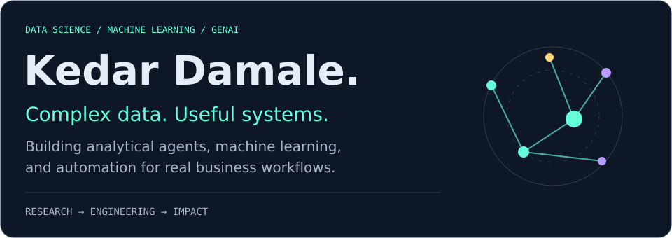](https://kedardamale.github.io/KedarDamale/)

  <a href="https://kedardamale.github.io/KedarDamale/"><b>Portfolio</b></a> &nbsp; · &nbsp;
  <a href="https://www.linkedin.com/in/kedar-damale-57252a324/"><b>LinkedIn</b></a> &nbsp; · &nbsp;
  <a href="https://kedardamale.github.io/KedarDamale/output/resume.pdf"><b>Résumé</b></a> &nbsp; · &nbsp;
  <a href="mailto:damalekedar@gmail.com"><b>Email</b></a>

I’m Kedar, an **ML & GenAI Engineer at Globalspace Technologies**. I build analytical agents, machine learning systems, and financial automation that connect data to everyday decisions. My work spans pharmaceutical intelligence, audit workflows, computer vision, and research infrastructure.

B.E. in Information Technology · University of Mumbai · **8.5 CGPA** · **GATE DA 2026 qualified**.

## Selected impact

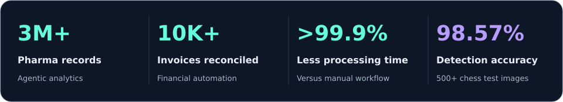

## Where I’ve worked

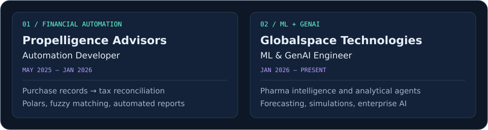

At **Globalspace**, I work on PatGPT’s analytical workflows over 3M+ pharmaceutical sales and tender records, with forecasting, simulations, evidence-grounded answers, and human review. I also build configurable budget and incentive calculations across organizational hierarchies.

At **Propelligence**, I automated purchase-register to GSTR-2B reconciliation with Polars and fuzzy matching. The module became part of Granska, used by **two CA firms and approximately 20 auditors**.

## Selected projects

  <a href="https://github.com/KedarDamale/Chessablanka">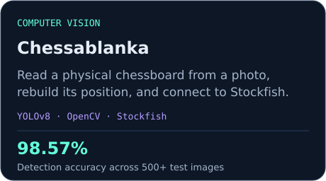</a>
  <a href="https://github.com/KedarDamale/NeuroTribe">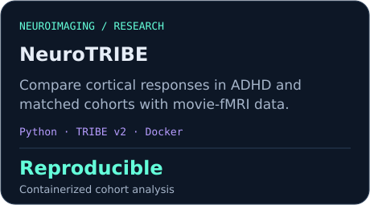</a>
  <a href="https://github.com/KedarDamale/ESP32-DBSCAN-Cattle-Monitoring-System">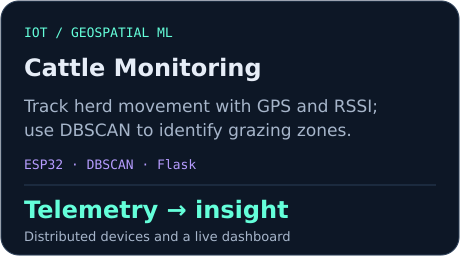</a>
  <a href="https://github.com/KedarDamale/automated_reconcillation">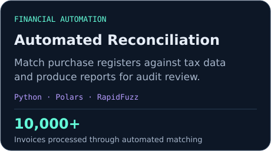</a>

[Explore more of my work →](https://github.com/KedarDamale?tab=repositories)

## Languages & tools

**ML & computer vision**

  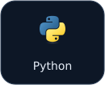
  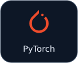
  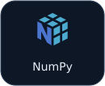
  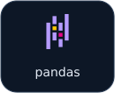
  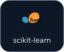
  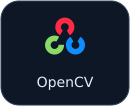

**GenAI & agents**

  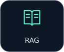
  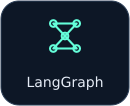
  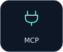
  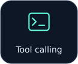

**APIs & data systems**

  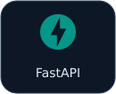
  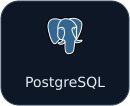
  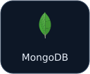
  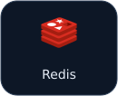

**Build & ship**

  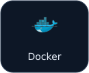
  
  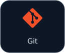
  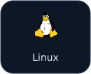
  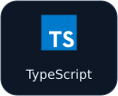
  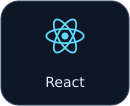

I enjoy problems where the model is one part of a larger system: reliable data pipelines, analytical agents, human review, and tools that make operational work easier.

## GitHub stats & activity

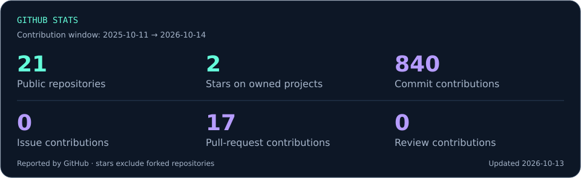

[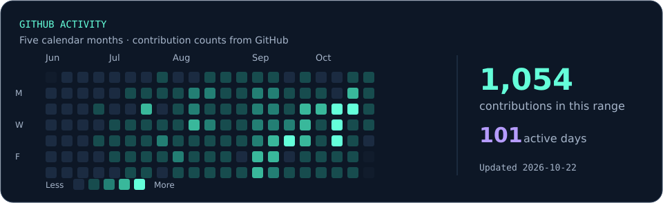](https://github.com/KedarDamale?tab=overview)

  <b>Have an interesting data or AI problem?</b> 
  <a href="mailto:damalekedar@gmail.com">Let’s talk.</a>

